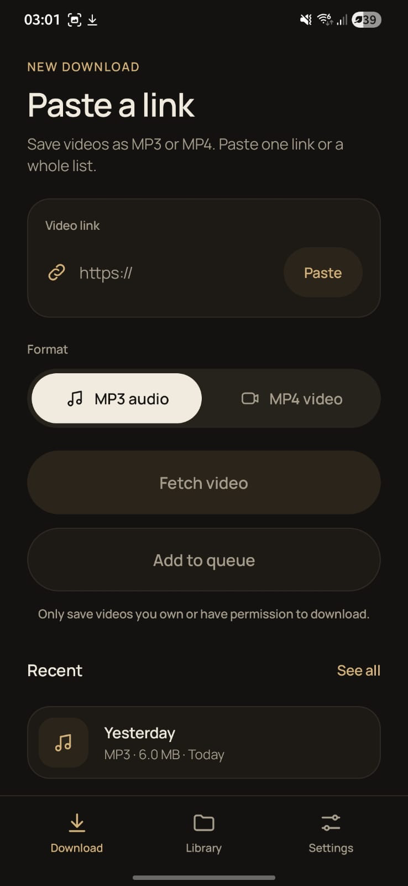
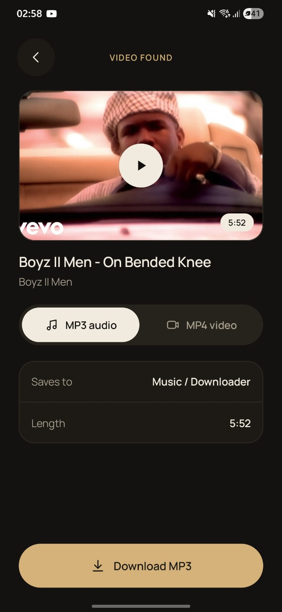
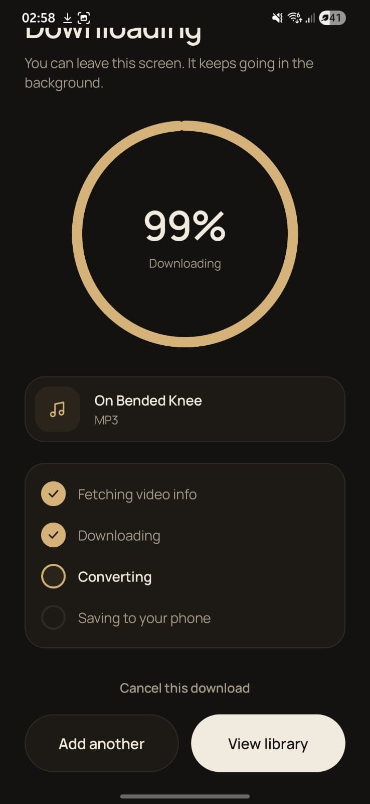
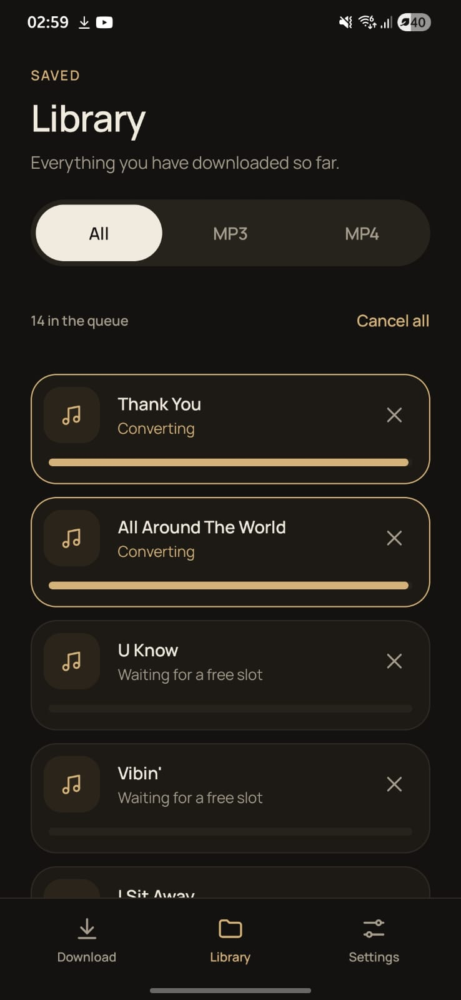
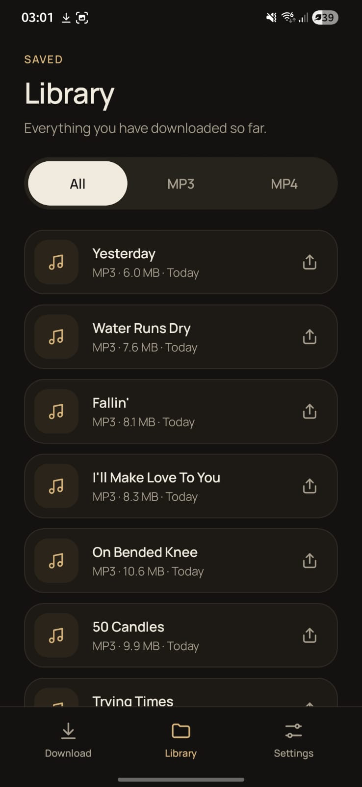

# AnyGrab

An Android app that saves videos and music from YouTube, TikTok, Instagram, Twitter/X, SoundCloud, and most other sites yt-dlp supports, straight to your phone as MP3 or MP4. Everything runs on the device, there is no server. I built it as a personal project to practise Jetpack Compose and to learn how to run a native tool (yt-dlp) inside an Android app.

## Screenshots

  
  
  
  
  

## What it does

- Paste a link and save it as MP3 or MP4 (choose the quality for video)
- Paste several links at once and they all go into a queue
- Paste a playlist or an album link and every track is added to the queue
- Several downloads run at the same time (you choose 1 to 3 in Settings)
- MP3 files get tags and a clean square cover. The app takes the sharpest thumbnail it can find, cuts off any black bars baked into it and crops it to a square that fills the whole cover (up to 1200 x 1200)
- Albums get their own folder with track numbers
- A notification shows the progress while the app is closed
- Share a link from another app to AnyGrab, and it can start downloading straight away (turn this on in Settings, and choose MP3 or MP4)
- Failed downloads try again automatically. When YouTube blocks a download (error 403) the app updates yt-dlp and then tries other YouTube clients that still work, and you can retry by hand
- A library screen with the cover of every song and a frame from every video, a search box, filters, share and delete
- Play your MP3 and MP4 files inside the app, with previous and next, and the next song starts on its own
- A mini player keeps the music going while you look around the app, with little bars bouncing on the song that is playing
- Swipe a song to the left to delete it, with an undo button in case it was a mistake
- If you copied a link, the paste screen offers it straight away, and it says which site a link is from (YouTube, TikTok, Instagram, X, SoundCloud and more)
- One main button that always does the next thing: paste when the box is empty, then continue
- The library shows how many songs and videos you have and how much space they take, and can switch to a grid of big covers
- The player puts a huge blurred copy of the cover behind everything, with a slim seek bar you can tap or drag
- A small celebration when a download finishes, and a "Saved" message with a play button when you are on another screen
- The preview shows the exact square cover your MP3 will get before you download it
- Option to only download on Wi-Fi, so it does not use mobile data
- Settings for the default format and quality, the save folder name, how many downloads run at once, Wi-Fi only, and a button to update yt-dlp by hand
- Add a cookies file for sites that need you to be logged in, like Instagram (YouTube only gets them when it asks for a login)
- Light and dark theme

## Built with

- Kotlin
- Jetpack Compose and Material 3
- [youtubedl-android](https://github.com/yausername/youtubedl-android) (the junkfood02 fork, version 0.18.1) for yt-dlp and ffmpeg
- Coroutines and StateFlow for the queue
- A foreground service for background downloads
- MediaStore so files show up in the normal Music and Movies folders

No navigation library and no database, to keep the dependencies small. The screens are switched with plain state, and the history is stored as JSON in SharedPreferences.

## How it is organised

- `data/DownloadController.kt` is the main part. It keeps the queue, runs the downloads and reads playlists
- `data/CoverArt.kt` makes the square cover and writes it into the MP3's ID3 tag
- `DownloadService.kt` keeps downloads alive in the background and shows the notification
- `ui/screens` has the screens: paste a link, preview, downloading, library, player and settings
- `ui/components` has the shared pieces like buttons, cards, the floating nav bar and the artwork loader
- `ui/theme` has the colors, fonts, shapes and the animation helpers

## The design

Deep graphite and soft paper white backgrounds with an "ember" gradient (amber to coral to pink) on the main button, progress, the app icon and a few highlighted words, so the cover art does most of the talking. Bold Manrope titles, rounded cards, pill buttons and a floating nav bar. Every screen has one clear main action, lists show real artwork, and the player takes its background glow from the song's cover. Animations use springs and turn off if the system animations are off.

## Tests

There are unit tests for the link detection, the title cleaning, the black bar trimming and the ID3 cover writer in `app/src/test`. Run them with `./gradlew test`.

## Running it

1. Open the project in Android Studio
2. Let Gradle sync
3. Run it on an emulator or a phone (Android 8 or newer)

The first launch takes a few seconds because the download engine has to unpack itself. The app only includes the arm64 and x86_64 versions of the engine, so it will not run on old 32 bit phones.

## Note

This is a personal and learning project. Only download things you own or have permission to save, and follow the terms of the sites you use. I do not support piracy.

## Credits

- [yt-dlp](https://github.com/yt-dlp/yt-dlp) and [youtubedl-android](https://github.com/yausername/youtubedl-android)
- [Manrope](https://fonts.google.com/specimen/Manrope) font (SIL Open Font License)
